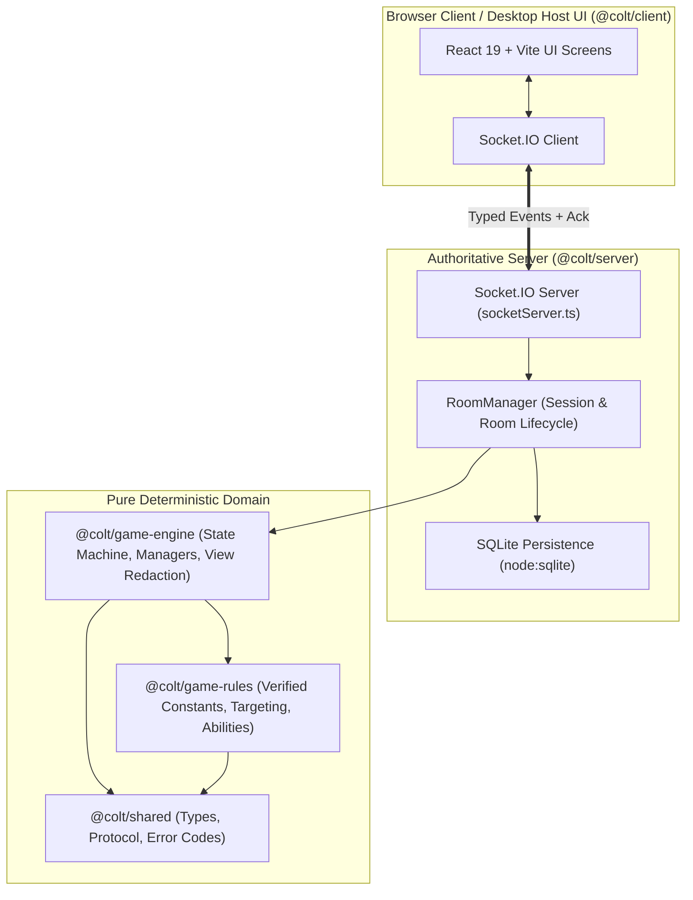
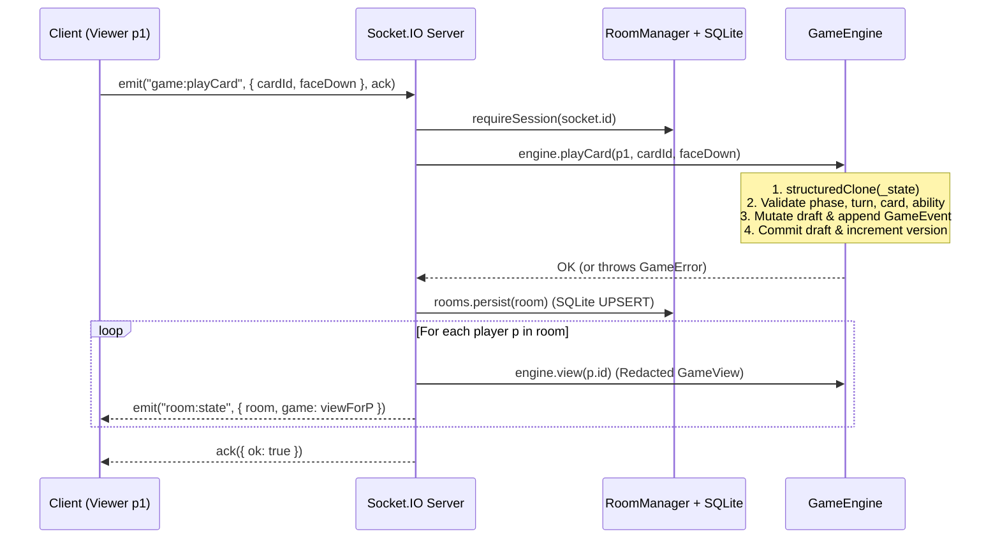

# COLT EXPRESS ONLINE — SYSTEM ARCHITECTURE (`ARCHITECTURE.md`)

## 1. Tổng quan Kiến trúc

Hệ thống được thiết kế theo mô hình **Authoritative Multiplayer Game Server** trên nền tảng **TypeScript Monorepo (npm workspaces)**. Máy chủ là nguồn dữ liệu có thẩm quyền duy nhất (Single Source of Truth); trình duyệt/client chỉ gửi **ý định hành động (intent commands)** và nhận về **khung nhìn đã lọc thông tin ẩn (`GameView`)**.

---

## 2. Phân tách 8 Lớp Hệ thống

| Lớp thành phần | Package / Thư mục | Trách nhiệm chính |
|---|---|---|
| **1. Shared Types** | [`shared/`](../shared/src/index.ts) | Định nghĩa kiểu dữ liệu miền (`GameState`, `PlayerState`, `TrainCar`, `RoundCard`...), khung nhìn (`GameView`), giao thức Socket.IO (`ClientToServerEvents`, `ServerToClientEvents`) và mã lỗi (`GameError`). |
| **2. Game Rules** | [`game-rules/`](../game-rules/src/index.ts) | Hằng số luật đã xác minh (`data.ts`), hàm thuần kiểm tra năng lực nhân vật (`abilities.ts`) và hàm tính toán mục tiêu/lựa chọn hợp lệ (`targeting.ts`). Không chứa trạng thái, không phụ thuộc I/O hay UI. |
| **3. Game Engine** | [`game-engine/`](../game-engine/src/index.ts) | Máy trạng thái hữu hạn (`stateMachine.ts`), bộ sinh số giả ngẫu nhiên có hạt giống (`rng.ts`), hệ thống sự kiện (`events.ts`), 7 Manager nghiệp vụ và bộ lọc thông tin ẩn (`view.ts`). |
| **4. Authoritative Server** | [`server/`](../server/src/index.ts) | HTTP server (`/api/health` + phục vụ bản build tĩnh của client), quản lý vòng đời phòng chơi (`RoomManager.ts`), điều phối lệnh vào `GameEngine`. |
| **5. Multiplayer Layer** | [`server/src/multiplayer/`](../server/src/multiplayer/socketServer.ts) | Xác thực phiên (`token`), ánh xạ socket theo từng người chơi, phát tán (`broadcastRoom`) khung nhìn `GameView` **riêng biệt cho từng người nhận** để chống lộ bài/túi tiền. |
| **6. Persistence Layer** | [`server/src/persistence/`](../server/src/persistence/Database.ts) | Lưu trữ trạng thái phòng chơi (`rooms`) và lịch sử kết quả ván (`game_results`) vào **SQLite** ở chế độ WAL, tự động khôi phục phòng khi khởi động lại server. |
| **7. Browser Client** | [`client/`](../client/src/App.tsx) | Ứng dụng React + Vite gồm 6 màn hình khung (`Main Menu`, `Create Room`, `Join Room`, `Lobby`, `Game Screen`, `Settings`), tự động khôi phục phiên qua `localStorage`. |
| **8. Windows Desktop Host** | [`desktop-host/`](../desktop-host/main.mjs) | Bộ nạp máy chủ cục bộ kết hợp giao diện client đóng gói cho môi trường Windows/Electron. |

---

## 3. Luồng Xử lý Lệnh Có Thẩm quyền (Authoritative Command Pipeline)

## 4. Nguyên tắc Bảo mật & Chống Gian lận (Anti-Cheat Guarantees)

1. **Client không bao giờ gửi kết quả**: Client chỉ gửi `cardId` (khi đánh bài) hoặc một `ResolutionChoice` nằm trong danh sách `pending.options` do chính Server sinh ra.
2. **Giao dịch nguyên tử (Atomic State Mutation)**: Mọi phương thức trong [`GameEngine`](../game-engine/src/GameEngine.ts) đều chạy trên bản sao `structuredClone(this._state)`. Nếu bất kỳ kiểm tra hợp lệ nào thất bại, ngoại lệ `GameError` được ném ra và trạng thái gốc hoàn toàn không bị biến đổi.
3. **Che giấu thông tin ẩn (Information Redaction)**: Hàm [`toView(state, viewerId)`](../game-engine/src/view.ts) loại bỏ:
   - Toàn bộ bài trên tay (`hand`) và chồng bài rút (`deck`) của đối thủ (chỉ trả về số lượng `handCount`, `deckCount`).
   - Mệnh giá thật của mọi Túi tiền (`purse`) trên tàu và của đối thủ (trả về `value: null` cho đến khi `phase === 'gameEnd'`).
   - Nội dung lá bài đánh úp (`faceUp === false`) của đối thủ trên `actionStack` cho đến khi được lật ở pha Execution.
   - Trạng thái hạt giống ngẫu nhiên `rngState` của máy chủ.
