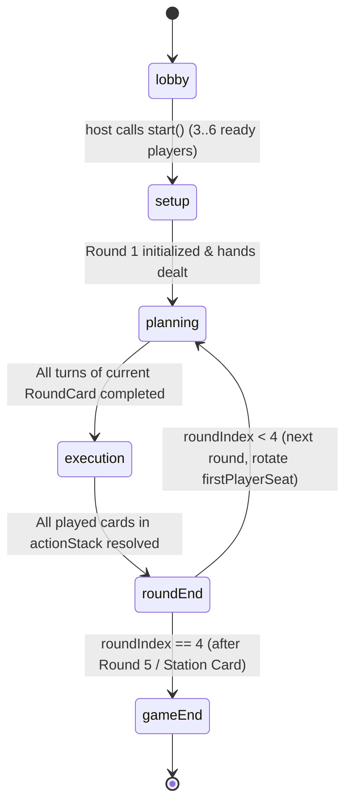

# COLT EXPRESS ONLINE — GAME STATE & STATE MACHINE (`GAME_STATE.md`)

Tài liệu mô tả cấu trúc dữ liệu trạng thái (`GameState`) trong [`shared/src/types.ts`](../shared/src/types.ts) và máy trạng thái (`stateMachine.ts`) trong [`game-engine/src/stateMachine.ts`](../game-engine/src/stateMachine.ts).

---

## 1. Máy trạng thái Ván chơi (Game Phase State Machine)

Bảng chuyển trạng thái hợp lệ (`TRANSITIONS`):

| Từ pha (`from`) | Sang pha hợp lệ (`to`) | Điều kiện kích hoạt |
|---|---|---|
| `lobby` | `setup` | 3–6 người chơi, mỗi người đã chọn nhân vật duy nhất và `ready = true`, chủ phòng gọi `start()`. |
| `setup` | `planning` | Khởi tạo đoàn tàu, chia túi tiền `$250`, rút 4 `RoundCard` + 1 `StationCard`, bắt đầu vòng 1. |
| `planning` | `execution` | Tất cả người chơi hoàn thành lượt cuối cùng của thẻ vòng hiện tại. |
| `execution` | `roundEnd` | Con trỏ `execution.index` đi hết `actionStack` và không còn `execution.pending`. |
| `roundEnd` | `planning` | Áp dụng sự kiện cuối vòng, gom bài về bộ bài cá nhân, nếu chưa hết 5 vòng thì tăng `roundIndex` và xoay `firstPlayerSeat`. |
| `roundEnd` | `gameEnd` | Đã hoàn thành vòng 5 (Thẻ Ga Tàu); tính điểm `scores` và xác định `winnerIds`. |
| `gameEnd` | *(không có)* | Trạng thái kết thúc. |

---

## 2. Cấu trúc Dữ liệu Cốt lõi (`GameState`)

### 2.1. `GameState` (Gốc trạng thái có thẩm quyền)
- `id: string` — Mã định danh ván/phòng.
- `phase: GamePhase` — `'lobby' | 'setup' | 'planning' | 'execution' | 'roundEnd' | 'gameEnd'`.
- `lobby: LobbyPlayer[]` — Danh sách người chơi khi ở phòng chờ (`id`, `name`, `character`, `ready`, `connected`).
- `hostId: string | null` — Người chơi chủ phòng.
- `players: PlayerState[]` — Danh sách tên cướp trong ván.
- `train: TrainCar[]` — Mảng các toa từ `0` (Đầu máy) đến `N` (Caboose).
- `marshalCar: number` — Chỉ số toa hiện tại của Cảnh sát trưởng (luôn ở tầng `inside`).
- `roundDeck: RoundCard[]` — 5 thẻ vòng của ván (4 thẻ thường + 1 thẻ ga tàu).
- `roundIndex: number` — Chỉ số vòng hiện tại (`0 .. 4`).
- `firstPlayerSeat: number` — Ghế của người đi đầu vòng hiện tại (`0 .. N-1`).
- `planning: PlanningState | null` — Trạng thái chi tiết khi đang ở pha `planning`.
- `actionStack: PlayedCard[]` — Chồng bài hành động chung theo thứ tự đánh ra.
- `execution: ExecutionState | null` — Trạng thái giải quyết bài khi ở pha `execution`.
- `neutralBullets: number` — Số lá Đạn Trung Lập còn lại (bắt đầu từ `13`).
- `reservePurses: Loot[]` & `spareStrongboxes: Loot[]` — Kho túi tiền dự trữ và hòm châu báu thứ hai bên ngoài tàu.
- `scores: ScoreLine[] | null` & `winnerIds: string[]` — Bảng điểm và danh sách người thắng khi `gameEnd`.
- `log: GameEvent[]` & `eventSeq: number` — Nhật ký sự kiện tuần tự của ván chơi.
- `rngState: number` — Hạt giống PRNG 32-bit (`mulberry32`) phục vụ tái hiện ván chơi tất định.
- `version: number` — Số thứ tự phiên bản trạng thái, tăng thêm 1 sau mỗi lệnh thành công.

### 2.2. `PlayerState` (Người chơi & Nhân vật)
- `id: string`, `name: string`, `character: CharacterId` (`'django' | 'tuco' | 'doc' | 'cheyenne' | 'ghost' | 'belle'`).
- `seat: number` — Thứ tự chỗ ngồi theo chiều kim đồng hồ (`0 .. N-1`).
- `position: Position` — `{ car: number, floor: 'inside' | 'roof' }`.
- `hand: PlayerCard[]` — Bài đang cầm trên tay (`ActionCard | BulletCard`).
- `deck: PlayerCard[]` — Chồng bài cá nhân (bao gồm các lá đạn bị bắn vào).
- `bullets: BulletCard[]` — Chồng 6 viên đạn cá nhân chưa bắn (`bullets` từ 1 đến 6).
- `loot: Loot[]` — Chiến lợi phẩm đang giữ.

### 2.3. `PlanningState` & `ExecutionState`
- `PlanningState`:
  - `turnIndex: number` — Lượt thứ mấy trên `RoundCard` hiện tại.
  - `order: string[]` — Thứ tự `playerId` trong lượt này (đã tính chiều thuận hay đảo chiều `switching`).
  - `orderIndex: number` — Con trỏ người chơi đang đến lượt.
  - `stepsTaken: number` — Số bước người chơi hiện tại đã thực hiện trong lượt (phục vụ lượt `speedingUp` cần 2 bước).
- `ExecutionState`:
  - `index: number` — Vị trí lá bài đang giải quyết trong `actionStack`.
  - `pending: PendingDecision | null` — Quyết định đang chờ người chơi chọn (`{ playerId, card, options: ResolutionChoice[] }`). Nếu chỉ có 0 hoặc 1 lựa chọn hợp lệ (khi bật `autoResolveSingleOption`), Engine tự động thực thi và tiến tới lá tiếp theo.
